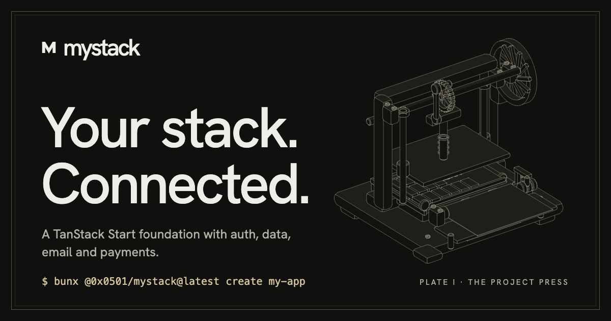

<p align="center">
  <a href="https://mystack.sumku.cc">
    
  </a>
</p>

<h1 align="center">Mystack</h1>

<p align="center">
  <strong>Configurable, production-grade TanStack Start application generator & platform template.</strong>
</p>

<p align="center">
  <a href="https://www.npmjs.com/package/@0x0501/mystack"></a>
  <a href="./LICENSE"></a>
  <a href="https://nodejs.org"></a>
  <a href="https://bun.sh"></a>
  <a href="https://tanstack.com/start"></a>
  <a href="https://mystack.sumku.cc"></a>
</p>

<p align="center">
  
</p>

---

Create a configured, production-ready **TanStack Start** application with **Mystack**. Instead of a rigid monolith or an empty starter, Mystack provides an interactive generator that lets you choose your database, deployment runtime, email, and payment providers.

Every generated project comes complete with hardened authentication (Better Auth with self-hosted OAuth2/OIDC provider, 2FA and passkeys), role-based administration, full-app internationalization (Paraglide JS), and headless Base UI presentation styled with Tailwind CSS v4.

> **Note:** Use `mystack create` to start new projects. This repository maintains the CLI and the canonical reference template; application development happens in the generated project.

## Quick Start

Install Node.js 22.12+ and [Bun](https://bun.sh). Run the CLI directly from npm to launch the interactive setup wizard:

```sh
bunx @0x0501/mystack
```

To create a project in a specific directory:

```sh
bunx @0x0501/mystack@latest create my-app
cd my-app
```

Follow the generated `README.md` to configure `.env`, apply database migrations, and start your dev server:

```sh
cp .env.example .env
bun run db:migrate
bun run dev
```

Open **http://localhost:3000**. In development, authentication emails are logged directly to the console when provider credentials are omitted.

### Common Recipes

#### 1. Zero-Cloud Local Development (Bun + SQLite)
No cloud accounts or Docker required — start building immediately:

```sh
bunx @0x0501/mystack@latest create my-app --yes --database bun-sqlite --deployment bun --email resend --payments none
cd my-app
cp .env.example .env
bun run db:migrate
bun run dev
```

#### 2. Cloudflare Edge Stack (PostgreSQL Hyperdrive + Workers)
The reference template configuration with edge deployment:

```sh
bunx @0x0501/mystack@latest create my-app --yes --database pg-hyperdrive --deployment cloudflare --email cloudflare --payments stripe
cd my-app
cp .env.example .env
bun run db:up      # Starts local Postgres in Docker Compose
bun run db:migrate
bun run dev
```

#### 3. Serverless Turso + Resend + Polar
Distributed libSQL storage with modern email and billing:

```sh
bunx @0x0501/mystack@latest create my-app --yes --database turso-cloud --deployment cloudflare --email resend --payments polar
```

## Compatibility

Mystack configures code, migrations, environment variables, and dependencies tailored to your chosen stack. The interactive wizard automatically disables incompatible combinations.

### Supported Integrations

| Category | Badges & Supported Integrations |
|---|---|
| **Runtimes** | [](https://workers.cloudflare.com/) [](https://nitro.unjs.io/) [](https://bun.sh/) |
| **Databases** | [](https://www.postgresql.org/) [](https://developers.cloudflare.com/d1/) [](https://turso.tech/) [](https://bun.sh/) |
| **Email** | [](https://developers.cloudflare.com/email-routing/) [](https://resend.com/) |
| **Payments** | [](https://stripe.com/) [](https://polar.sh/) [](https://creem.io/) [](https://nowpayments.io/) |

### Database & Deployment Matrix

| Database Option | Flag | Supported Deployments | Connection & Characteristics |
|---|---|---|---|
| **PostgreSQL (Hyperdrive)** | `pg-hyperdrive` | Cloudflare Workers | Cloudflare `HYPERDRIVE` connection pooling |
| **PostgreSQL (Direct)** | `pg` | Nitro / Node.js, Bun | Direct `DATABASE_URL` app-role connection |
| **Cloudflare D1** | `d1` | Cloudflare Workers | Cloudflare `DB` native binding |
| **Turso Cloud** | `turso-cloud` | Cloudflare, Nitro, Bun | Local `.local/turso-local.db` in dev; remote `libsql://` in prod |
| **Turso Local (libSQL)** | `turso-local` | Nitro / Node.js, Bun | Local `file:.local/turso-local.db` (no cloud tokens required) |
| **Bun SQLite** | `bun-sqlite` | Bun | Native `bun:sqlite` engine (`local.db`) |

Your choices are recorded in `mystack.json` for reference.

## Features & Platform Capabilities

Mystack ships platform infrastructure so you can focus on building your product:

- 🛡️ **Hardened Better Auth**: Email/password authentication, GitHub OAuth, passkeys (WebAuthn), and two-factor authentication (2FA).
- 🔑 **OAuth 2.0 / OIDC Provider**: Built-in identity provider issuing tokens and exposing RFC discovery metadata (`/.well-known/openid-configuration`, `/.well-known/oauth-authorization-server/api/auth`).
- ⚡ **TanStack Start & React 19**: Full-stack type-safety, streaming SSR, TanStack Router file-based routing, server functions (`createServerFn`), and TanStack Query state caching.
- 🌐 **Full-App i18n**: First-class internationalization powered by Paraglide JS with SEO-friendly localized URL paths (`/`, `/de`) and automatic user locale persistence.
- 🎨 **Headless UI & Tailwind CSS v4**: Modular Base UI (`@base-ui/react`) primitives with customizable Tailwind CSS v4 design tokens and dark mode support.
- 🔒 **Row-Level Security (RLS)**: Isolated database transaction scopes with tenant/service context helpers.
- 🎛️ **Admin Console & Audit Log**: Role-based access control, peer admin protection, OAuth client management, and audit log tracking.
- 💳 **Pluggable Payments**: Modular checkout and webhook handling for Stripe, Polar, Creem, and NOWPayments (or `none`).

## Repository Structure

| Path | Purpose |
|---|---|
| Root (`src/`, `scripts/`, `drizzle/`) | Canonical runnable reference template (PostgreSQL + Cloudflare Workers) |
| [`packages/mystack/`](./packages/mystack/) | CLI generator, option catalog, and template adapters (`@0x0501/mystack`) |
| [`packages/website/`](./packages/website/) | Marketing site and catalog-backed stack configurator ([mystack.sumku.cc](https://mystack.sumku.cc)) |
| [`docs/`](./docs/) | Architectural decision records (ADRs), specs, and maintainer guides |

The root application is the canonical template source. See [ADR 0012](./docs/adr/0012-mystack-project-generation.md) for details on composition and template bundling.

## Documentation

- [Getting started](./docs/getting-started.md) — CLI installation, flags, and deployment walkthrough
- [Project guide](./docs/project-guide.md) — Working inside a generated application (bundled with the CLI)
- [Reference template](./docs/reference-template.md) — Maintainers' setup for the PostgreSQL / Workers reference app
- [Design](./DESIGN.md) — Headless Base UI integration, design tokens, and motion
- [Contributing](./docs/contributing.md) — Developing adapters and maintaining the CLI
- [Publishing](./docs/publishing.md) — Packaging and automated release workflows
- [Context & Glossary](./CONTEXT.md) — Ubiquitous language and architecture invariants
- [Documentation index](./docs/README.md) — Complete documentation and ADR catalog

## License

[MIT](./LICENSE)
